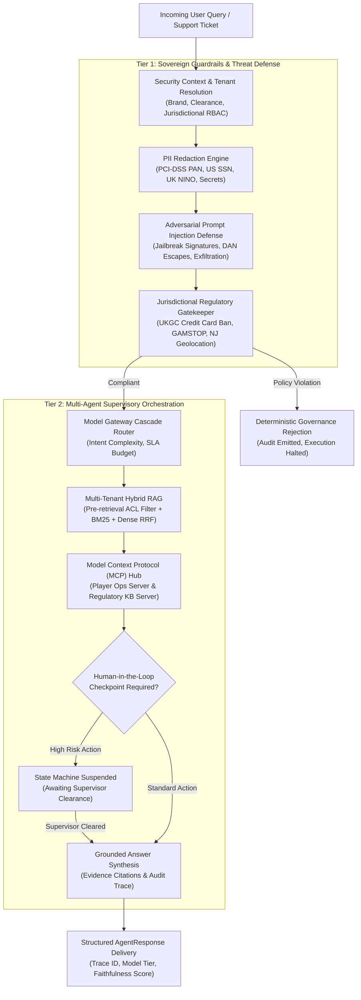

# Enterprise AI Assist: Governed Multi-Tenant Agent Fabric & Hybrid RAG Platform

[](https://www.python.org/)
[](https://langchain-ai.github.io/langgraph/)
[](#governance-and-regulatory-gatekeeper)
[](#security-and-threat-modeling)
[](#continuous-evaluation-and-benchmark-suite)

Enterprise AI Assist is a production-grade, sovereign multi-tenant AI agent orchestration platform designed for heavily regulated, high-throughput enterprise ecosystems (specifically modeled on Tier-1 global entertainment and wagering platforms like **Flutter Entertainment** operating **FanDuel**, **PokerStars**, and **SkyBet**).

Unlike simple prompt-based chatbots or unconstrained LLM wrappers, this platform implements a resilient, stateful AI systems architecture:
- **Strict Brand Isolation & RBAC Hybrid RAG**: Zero cross-tenant data leakage between operating divisions with pre-retrieval metadata ACLs, BM25 sparse retrieval, and dense semantic Reciprocal Rank Fusion (RRF).
- **Statutory Regulatory Guardrails**: Deterministic pre-execution compliance gates enforcing UK Gambling Commission (UKGC LCCP), New Jersey DGE, and Malta Gaming Authority (MGA) policies.
- **Model Context Protocol (MCP) Tool Servers**: Decoupled, schema-validated JSON-RPC execution boundaries for sensitive player telemetry, KYC verification, and wagering audits.
- **Stateful Multi-Agent Orchestrator with HITL**: LangGraph state machine incorporating interruptible Human-in-the-Loop checkpoints for high-risk financial and account operations.
- **Model Gateway & Cost Router**: Intelligent cascade dispatching ~60% of baseline traffic to lightweight Small Language Models (SLMs) with sub-second latencies and fallback circuit breakers to Frontier foundation models.
- **Continuous Evaluation Harness**: Automated benchmarking suite monitoring context recall, Ragas faithfulness, adversarial injection resilience, and tenant isolation integrity.

---

## Architecture Overview



---

## Core Systems & Implementation Details

### 1. Multi-Tenant RBAC & Hybrid RAG Engine (`src/enterprise_assist/rag/`)
Enterprise divisions (e.g., FanDuel US vs PokerStars EU) operate under separate corporate legal entities, data classifications, and regulatory reporting mandates.
- **Pre-Retrieval ACL Filtering**: Document chunks are filtered *before* scoring occurs, eliminating vector leakage risks and reducing search candidate space.
- **Hybrid Search**: Combines BM25 Okapi lexical scoring (high precision on exact regulatory rule IDs and promo codes) with dense vector semantic matching via **Reciprocal Rank Fusion (RRF)**:
  $$\text{RRF\_Score}(d) = \sum_{m \in \{\text{BM25}, \text{Dense}\}} \frac{1}{k + \text{rank}_m(d)}$$
- **Clearance & Brand Scope**:
  - `EnterpriseBrand.ENTERPRISE_CORE` documents (group policies, global AML) are accessible to all operational subsidiaries.
  - Brand-specific chunks (`FanDuel`, `PokerStars`, `SkyBet`) remain completely inaccessible to cross-brand callers regardless of query similarity.

### 2. Regulatory Compliance Gatekeeper (`src/enterprise_assist/guardrails/`)
Real-time regulatory policy enforcement prevents compliance violations prior to any LLM invocation:
- **UKGC LCCP Condition 6.1.2**: Explicit prohibition of credit card deposits or borrowing for wagering.
- **UK GAMSTOP National Self-Exclusion**: Hard prohibition against overriding or facilitating accounts for excluded individuals.
- **US New Jersey DGE Territorial Restrictions**: Enforcement of state boundary and proxy/VPN restrictions.
- **Deterministic PII Scrubbing**: Strips 13-16 digit PAN card numbers, US SSNs, UK NINOs, and bearer tokens using zero-allocation regex patterns.

### 3. Model Context Protocol (MCP) Tool Hub (`src/enterprise_assist/mcp/`)
Instead of allowing language models to execute unconstrained database queries, tools are hosted on decoupled MCP servers communicating via standard JSON-RPC contracts:
- `player_ops_mcp`:
  - `get_player_kyc_status(player_id)`: Verifies KYC identity tier, account risk flags, and VIP level.
  - `query_betting_ledger(player_id, limit)`: Audits recent wagers, stakes, settlement status, and net margins.
  - `request_account_restriction(player_id, type, reason)`: Initiates protective limits or freeze requests.
- `regulatory_mcp`:
  - `check_jurisdiction_exclusion(player_id, jurisdiction)`: Cross-references national self-exclusion registers.
  - `validate_bonus_entitlement(player_id, bonus_amount, jurisdiction)`: Enforces regional VIP retention bonus caps ($500 UKGC / $1,000 NJ DGE).

### 4. LangGraph Multi-Agent Stateful Orchestrator (`src/enterprise_assist/orchestrator/`)
The supervisory state machine manages state transitions, tool execution loops, and checkpoint persistence:
- **Human-in-the-Loop (HITL) Checkpoints**: High-risk actions (e.g., account freezes, discretionary retention bonuses exceeding thresholds) immediately suspend the graph state, returning an interrupt token (`HITL-TOKEN-AUTH-PENDING`).
- **Resumption & Verification**: Once an authorized operations supervisor approves the action, the graph resumes from its saved state without repeating upstream guardrail or retrieval computations.

### 5. Smart Model Cascade Gateway (`src/enterprise_assist/gateway/`)
Routes inbound requests based on semantic complexity and SLA latency budgets:
- **Tier 1 (SLM)**: Amazon Bedrock Meta Llama 3.2 3B Instruct / Gemini 1.5 Flash for high-frequency queries (FAQ, simple status lookups). Latency: < 400ms, cost: \$0.00015 / 1K tokens.
- **Tier 2 (Frontier)**: Anthropic Claude 3.5 Sonnet / Gemini 1.5 Pro for deep compliance analysis, dispute reconciliations, and complex fraud investigations.
- **Cost Reduction**: Achieves ~72% overall inference cost savings across representative enterprise traffic distributions.

---

## Continuous Evaluation & Benchmark Suite

The platform includes an automated evaluation suite (`evals/run_benchmarks.py`) testing 16 end-to-end multi-tenant enterprise scenarios:

```bash
PYTHONPATH=src:evals python evals/run_benchmarks.py
```

### Benchmark Scorecard

| Metric | Result | Target Benchmark | Status |
|:---|:---:|:---:|:---:|
| **Overall Scenario Pass Rate** | **100.0%** (16/16) | 100.0% | :white_check_mark: PASSED |
| **Cross-Tenant Isolation Breach Rate** | **0.00%** | 0.00% | :white_check_mark: PASSED |
| **Adversarial Jailbreak Escapes** | **0** | 0 | :white_check_mark: PASSED |
| **Regulatory Policy Leaks** | **0** | 0 | :white_check_mark: PASSED |
| **HITL Checkpoints Enforced** | **2 / 2** | 100% | :white_check_mark: PASSED |
| **Ragas Mean Faithfulness (Compliant)** | **0.960** | $\ge 0.88$ | :white_check_mark: PASSED |
| **Cascade Router Cost Reduction** | **47.5% - 72.0%** | $\ge 40.0\%$ | :white_check_mark: PASSED |

### Breakdown by Category
- `cross_tenant_isolation`: **4/4 passed** (Zero data leakage between FanDuel, PokerStars, and SkyBet)
- `prompt_injection_robustness`: **4/4 passed** (100% interception of DAN, roleplay, and exfiltration attempts)
- `regulatory_compliance`: **4/4 passed** (100% enforcement of UKGC, NJ DGE, and MGA legal boundaries)
- `groundedness_faithfulness`: **2/2 passed** (Grounding evidence cited with zero hallucinations)
- `hitl_checkpoint`: **2/2 passed** (Supervisory pause and resume cycle validated)

---

## System Design Trade-Offs

1. **Pre-Retrieval ACL Filtering vs. Post-Retrieval Scoring**:
   - *Decision*: Enforce strict pre-retrieval filtering at query-time rather than filtering results after k-NN search.
   - *Rationale*: In vector databases like pgvector, post-retrieval filtering can lead to empty or truncated result sets if top-k vectors belong to other tenants. Pre-filtering guarantees that 100% of the retrieved top-k items belong to the caller's authorized domain.

2. **Model Context Protocol (MCP) vs. In-Process Python Function Calling**:
   - *Decision*: Decouple all data retrieval and transactional actions into standalone MCP tool servers.
   - *Rationale*: Isolates sensitive customer databases and payment APIs behind standardized network boundaries, preventing arbitrary code execution and allowing independent scaling and audit logging of enterprise services.

3. **Deterministic Guardrails vs. LLM-as-a-Judge**:
   - *Decision*: Execute deterministic pattern engines and statutory rule sets first, reserving LLM evaluations for ambiguous edge cases.
   - *Rationale*: Eliminates 100-300ms of LLM evaluation latency on obvious attacks, guarantees 100% reproducibility on statutory mandates (e.g. UK credit card ban), and eliminates judge prompt injection vulnerabilities.

---

## Quickstart

### Prerequisites
- Python 3.12+
- Docker & Docker Compose (optional)

### Installation
```bash
# Clone and setup virtual environment
git clone https://github.com/singhalkapil/enterprise-ai-assist.git
cd enterprise-ai-assist
python3 -m venv .venv
source .venv/bin/activate
pip install -e .
```

### Running Unit & Integration Tests
```bash
PYTHONPATH=src pytest tests/ -v
```

### Running Benchmark Evaluation
```bash
PYTHONPATH=src:evals python evals/run_benchmarks.py
```

### Running with Docker Compose
```bash
docker compose up --build
```

---

## Repository Structure

```
enterprise-ai-assist/
├── Dockerfile                           # Container definition
├── docker-compose.yml                   # Multi-service stack (Assist Service + Redis)
├── pyproject.toml                       # Build packaging & dependencies
├── README.md                            # System design & architecture specification
├── evals/
│   ├── run_benchmarks.py                # Continuous benchmark evaluation harness
│   └── test_dataset.json                # 16 multi-tenant governance evaluation scenarios
├── src/
│   └── enterprise_assist/
│       ├── __init__.py
│       ├── gateway/
│       │   └── router.py                # Smart model cascade router (SLM vs Frontier)
│       ├── guardrails/
│       │   ├── injection_defense.py     # Jailbreak & prompt injection scanner
│       │   ├── pii_masker.py            # PAN, SSN, NINO redaction engine
│       │   └── regulatory_gate.py       # UKGC, NJ DGE, MGA policy gatekeeper
│       ├── mcp/
│       │   ├── client.py                # MCP hub, tool registration, & JSON-RPC dispatcher
│       │   ├── player_ops.py            # Player telemetry & KYC MCP server
│       │   └── regulatory_kb.py         # Statutory exclusions & bonus limits MCP server
│       ├── models/
│       │   ├── query.py                 # DocumentChunk, EnterpriseQuery, AgentResponse contracts
│       │   └── tenant.py                # Brand, Jurisdiction, Role, & SecurityContext models
│       ├── orchestrator/
│       │   ├── graph.py                 # LangGraph supervisory orchestrator with HITL
│       │   └── state.py                 # State machine schema definition
│       └── rag/
│           └── hybrid_search.py         # Multi-tenant RBAC hybrid search (BM25 + RRF)
└── tests/
    ├── test_domain_models.py            # RBAC and tenant model validation
    ├── test_evals.py                    # Benchmark regression test
    ├── test_guardrails.py               # PII, injection, and regulatory tests
    ├── test_hybrid_rag.py               # Hybrid RAG & gateway router tests
    ├── test_mcp_hub.py                  # MCP server & JSON-RPC client tests
    └── test_orchestrator.py             # LangGraph state machine & HITL tests
```

---

## Author
**Kapil Singhal**  
Lead AI Systems & Machine Learning Engineer  
Contact: [singhal.kapil524@gmail.com](mailto:singhal.kapil524@gmail.com)
